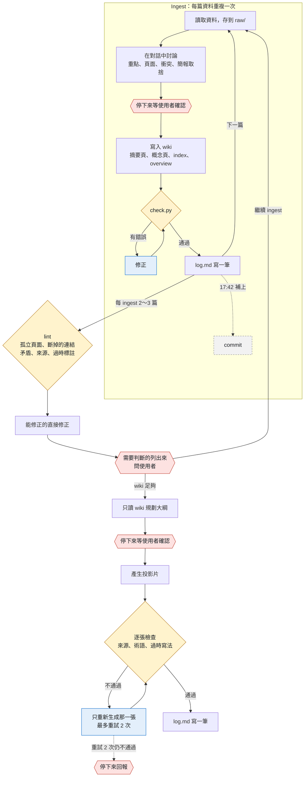
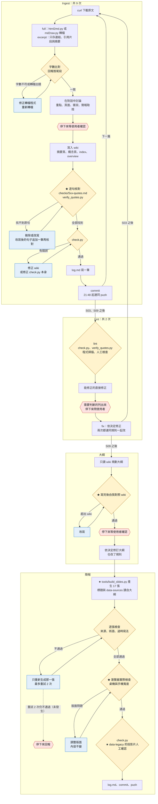

# WORKFLOW：流程設計與實際執行的回顧

這份文件依 [wiki/log.md](wiki/log.md) 與 [checks/](checks/) 的 5 份對照表整理，log.md 與 checks/ 沒有記錄的事不寫。

- 第 1、2、4 節的範圍是 log.md 到 11-23 10:12 為止的 25 筆紀錄，也就是 wiki、大綱、簡報的製作過程。
- 第 3 節另外列入 11-23 17:39 那筆，也就是新增這份文件時一起更新的結構說明。

- 文中的時間對應 log.md 每筆紀錄的標題，年份都是 2026，例如「11-22 18:42」就是 log.md 的「2026-11-22 18:42」。
- 只有一個例外：v1 流程圖的步驟取自 CLAUDE.md 最早的版本，也就是 git 中第一次 commit 的 `e3bdbd8`，因為 log.md 只記錄規則的修改，沒有抄錄原本的規則。第一次 commit 時，17:42 那筆紀錄所補上的部分已經寫進規則，v1 圖中把這部分扣掉並另外標示。

## 1. 流程圖

圖例：

| 形狀 | 意思 |
|---|---|
| 菱形（黃色） | 檢查 |
| 六角形（紅色） | 停下來等使用者確認或回報 |
| 方框（藍色） | 檢查不通過後的修正或重新生成，箭頭會回到檢查 |
| 外框 | 外框內的步驟會重複執行，框的標題寫明重複幾次 |
| 虛線 | 規則中有、但實際沒有發生，或之後才補上 |
| ★ | v1 沒有、之後才加入的步驟 |

### v1：最初設計的流程（11-22 17:03 建立專案時）

17:42 的紀錄（「規則調整與 git init」）在第一篇 ingest 之前補上兩件事：`stored: full` 必須用 curl 下載並用程式轉檔，以及 ingest 最後要 commit。所以 S01 起的每一次 ingest，實際上都有這兩步。

### v2：目前實際使用的流程

v2 圖中的 Ingest 外框是 S01～S09 每篇各一次，共 9 次。Lint 外框實際執行 2 次，範圍是 S01～S03 與 S04～S09。

### v1 到 v2 的主要差異

| 差異 | 加入的時間 | 依據 |
|---|---|---|
| 存入 raw 改成 curl 下載、程式轉檔、比對字數 | 11-22 17:42 | 17:42 setup 紀錄 |
| ingest 最後 commit | 11-22 17:42 | 17:42 setup 紀錄 |
| 寫入 wiki 後加入逐句核對 | 11-22 19:22，19:47 改成 `checks/` 與 `verify_quotes.py` | 19:22、19:47 setup 紀錄 |
| 對照表 commit 後只能往後新增 | 11-22 21:24 | 21:24 fix 紀錄 |
| 大綱寫完後自我對照 wiki | 11-22 21:26 | 21:26 outline 紀錄的「檢查結果」 |
| commit 之後 push 到 GitHub | 11-22 21:48 | 21:48 setup 紀錄 |
| 簡報經瀏覽器實際檢查版面 | 11-22 22:00 | 22:00 slide 紀錄（CLAUDE.md 沒有這一步） |
| 有 data-legacy 的投影片要人工確認過時寫法 | 11-23 10:12 | 10:12 slide 紀錄 |
| 簡報由 `tools/build_slides.py` 產生 | 11-23 10:12 | 10:12 setup 紀錄 |
| lint 的實際間隔 | S03 之後（3 篇）、S09 之後（6 篇） | 18:42、21:03 lint 紀錄，S04～S09 一起做是 20:19 的討論結果 |

## 2. 各節點的錯誤統計

計算方式：

- 依「問題出在哪個節點」歸類，再記錄它「在哪個步驟被發現」。
- log.md 中描述為一處錯誤、一處修正或一項需要判斷的事項，算一個問題。
- 同一個原因造成的多個錯誤訊息只算一個，例如 17:46 check.py 的 9 個警告。
- 為了套用新規則而做的大量修改不算問題，例如 19:17 把既有頁面的 108 個分號改掉。
- 大綱階段發現 wiki 缺少的資料（21:26 的「待找資料」）屬於資料範圍，不算錯誤。

### 總表

| 問題出在哪個節點 | 問題數 | 在哪個步驟被發現（次數） | 實例 |
|---|---|---|---|
| 存入 raw | 4 | 存入 raw 時的轉檔或字數比對 2、ingest 討論 1、log 未寫明 1 | 11-22 18:03：html2md.py 轉出的 markdown 比 HTML 正文少 9 個字，逐字比對後確認是字數計算把 git diff 範例中的 markdown 連結語法當成連結、扣掉網址，內容沒有遺漏 |
| ingest 討論 | 1 | 寫入 wiki 時 1 | 11-22 20:03：討論時說「S06 說 clone 會自動加上 origin，和 S04 一致」，但 S04 沒有提到 origin，寫入摘要頁時改寫，沒有寫進 wiki |
| 寫入 wiki | 16 | lint 9、逐句核對 4、check.py 1、S04 套用分號規則時逐行檢查 1、寫完摘要頁後自我檢查 1 | 11-22 19:31：S05 摘要頁寫「它會用新的 commit 完全取代舊的，所以只能用在還沒 push 的 commit」，原文沒有「所以」的因果關係，逐句核對時改寫成兩句 |
| 逐句核對 | 1 | lint 1 | 11-22 21:03：S07 對照表第 25 筆「把目前的工作目錄切換到本地專案」通過驗證（英文原句確實存在），但「工作目錄」和 wiki 中 Git 的工作目錄（working tree）撞名，到 lint 才發現 |
| lint | 4 | lint 人工確認 2、S04 套用分號規則時逐行檢查 1、使用者看 lint 回報 1 | 11-22 21:24：21:03 的 lint 直接改寫了已 commit 的 S07 對照表第 25 筆，使用者決定對照表比照 log.md 只能往後新增，第 25 筆恢復原狀，改寫後的句子追加為第 55 筆 |
| 大綱 | 3 | 大綱寫完後自我對照 wiki 3 | 11-22 21:26：第 11 張原本寫「origin 是 Git 預設的遠端名稱」，wiki 的說法是 clone 時的預設名稱，改寫並補上 GitHub Docs 也用 origin |
| 簡報 | 11 | 瀏覽器實際檢查 6、逐張檢查 5 | 11-22 22:00：第 4 張把 wiki 範例的 John Doe 換成「你的名字」佔位字，超出只允許改分支名稱的改編範圍，重新生成時改用 wiki 的範例原樣 |
| 檢查規則本身 | 9 | ingest 討論 4、check.py 2、lint 1、S04 套用分號規則時 1、簡報完成後的討論 1 | 11-22 20:19：「用帳號密碼推送」規則只比對字面，但 S08 的現行做法就是在「Password:」提示輸入 token，照現行做法寫的投影片會被誤判，改成同一張出現 token 時不報錯 |
| **合計** | **49** | | |

### 依「發現的步驟」統計

| 發現的步驟 | 次數 | 發現了哪些節點的問題 |
|---|---|---|
| lint | 13 | 寫入 wiki 9、逐句核對 1、檢查規則本身 1、lint 自己的掃描誤判 2 |
| 瀏覽器實際檢查 | 6 | 簡報 6 |
| ingest 討論 | 5 | 檢查規則本身 4、存入 raw 1 |
| 逐張檢查 | 5 | 簡報 5 |
| 逐句核對 | 4 | 寫入 wiki 4 |
| check.py | 3 | 檢查規則本身 2、寫入 wiki 1 |
| 大綱寫完後自我對照 wiki | 3 | 大綱 3 |
| S04 套用分號規則時逐行檢查 | 3 | 寫入 wiki 1、lint 1、檢查規則本身 1 |
| 存入 raw 時的轉檔或字數比對 | 2 | 存入 raw 2 |
| 寫入 wiki 當下 | 2 | ingest 討論 1、寫入 wiki 1 |
| 使用者看 lint 回報 | 1 | lint 1 |
| 簡報完成後的討論 | 1 | 檢查規則本身 1 |
| log 未寫明 | 1 | 存入 raw 1 |

### 明細

存入 raw（4）

| # | log 時間 | 問題 | 發現的步驟 |
|---|---|---|---|
| 1 | 11-22 17:46 | 轉檔程式第一次執行時，終端機 cp950 編碼無法輸出 U+2009 字元而中斷（markdown 檔已完整寫出），修正輸出編碼後重跑，結果與第一次相同 | 存入 raw 時執行轉檔 |
| 2 | 11-22 18:03 | html2md.py 字數計算誤扣網址，markdown 比 HTML 正文少 9 個字，內容沒有遺漏 | 存入 raw 時的字數比對 |
| 3 | 11-22 19:31 | html2md.py 把 h4 標題轉成與 h3 同級的 ###，改為 #### | log 未寫明，S05 ingest 時修正 |
| 4 | 11-22 21:02 | S09 的 license 原本寫「未標示（GitHub Blog，非 CC 授權）」，使用者指出網頁只是沒有標示授權，改成「未標示」（當時 raw 還沒 commit） | ingest 討論 |

ingest 討論（1）

| # | log 時間 | 問題 | 發現的步驟 |
|---|---|---|---|
| 1 | 11-22 20:03 | 討論時說「S06 說 clone 會自動加上 origin，和 S04 一致」，但 S04 沒有提到 origin，寫入摘要頁時改寫成「S06 補充了 S04 沒有提到的部分」，沒有寫進 wiki | 寫入 wiki 時 |

寫入 wiki（16）

| # | log 時間 | 問題 | 發現的步驟 |
|---|---|---|---|
| 1 | 11-22 18:40 | 執行 check.py 時還沒更新 index.md，3 個錯誤 | check.py |
| 2 | 11-22 18:42 | S01 摘要頁寫「線上版會持續修訂」，S01 原文沒有這個說法，屬於寫入時的推論 | lint |
| 3 | 11-22 18:42 | commit.md、git-status.md、default-branch.md 三處「過時／現行做法」區塊用字不一致 | lint |
| 4 | 11-22 18:42 | 3 組只有單向的相關頁面連結 | lint |
| 5 | 11-22 18:42 | 「過時／現行做法」區塊在三頁重複出現，之後修改容易漏改（需要判斷，18:46 改成只寫在 default-branch.md） | lint |
| 6 | 11-22 19:17 | version-control.md 把 Git 寫成「最常見的」分散式版本控制系統，raw 沒有依據，改成「一種」 | S04 套用分號規則時逐行檢查 |
| 7 | 11-22 19:31 | S05 摘要頁「它會用新的 commit 完全取代舊的，所以只能用在還沒 push 的 commit」，原文沒有「所以」的因果關係，改寫 | 逐句核對 |
| 8 | 11-22 19:31 | S05 摘要頁「線上版已修訂，包含 Git 2.23.0 新增的 git restore」，原文沒有說 Git 2.23.0 晚於印刷版，刪除 | 逐句核對 |
| 9 | 11-22 19:31 | S03 摘要頁「線上版已修訂，包含 Git 2.28 之後才有的預設分支設定」，同樣是推論，刪除 | 逐句核對（順帶核對上一輪） |
| 10 | 11-22 19:31 | S03 摘要頁「線上版加入 Git 2.28 的內容」，「加入」暗示是後來才加的，改寫 | 逐句核對（順帶核對上一輪） |
| 11 | 11-22 20:11 | S07 摘要頁的時效風險寫「GitHub 的介面與建議做法可能改版」是推測，改寫成「網頁沒有標示年份，無法判斷內容寫於何時」 | 寫完摘要頁後、建立對照表前的自我檢查 |
| 12 | 11-22 21:03 | git-clone.md 提到 master 但沒有連到 default-branch.md | lint |
| 13 | 11-22 21:03 | git-init.md 直接寫 S03 的「git init 預設建立 master」，沒有提醒與 S07 說法不一致 | lint |
| 14 | 11-22 21:03 | push-to-github.md 把 current working directory 譯成「目前的工作目錄」，與 Git 的工作目錄（working tree）撞名 | lint |
| 15 | 11-22 21:03 | overview.md 的簡報取捨仍寫「如果採用先 git init 的路線」，路線 A 已於 S07 決定 | lint |
| 16 | 11-22 21:03 | overview.md 漏記 --amend 與一律用 -m 的矛盾這個待決事項（原本只記在 log.md），規劃大綱時只能讀 wiki | lint |

逐句核對（1）

| # | log 時間 | 問題 | 發現的步驟 |
|---|---|---|---|
| 1 | 11-22 21:03 | S07 對照表第 25 筆「在終端機中，把目前的工作目錄切換到本地專案。」在 20:11 通過驗證，英文原句確實存在，但中文譯名與 Git 的工作目錄撞名（即上表「寫入 wiki」第 14 項）。verify_quotes.py 只驗證英文原句存在於 raw | lint |

lint（4）

| # | log 時間 | 問題 | 發現的步驟 |
|---|---|---|---|
| 1 | 11-22 19:17 | 18:46 lint 後續修正把過時區塊移到 default-branch.md，但 S02 摘要頁的連結仍指向 git-status.md 的時效註記，改連 default-branch.md | S04 套用分號規則時逐行檢查 |
| 2 | 11-22 21:24 | 21:03 的 lint 直接改寫已 commit 的 checks/S07-quotes.md 第 25 筆，使用者決定對照表只能往後新增，恢復第 25 筆並追加第 55 筆 | 使用者看 lint 回報後的決定 |
| 3 | 11-22 21:03 | lint 的程式掃描把 overview.md「簡報範圍決定」的引言列為沒有來源的句子，確認不是事實陳述，不需修改 | lint 人工確認 |
| 4 | 11-22 21:03 | lint 的程式掃描把 commit.md 的「密碼」列為用密碼驗證，實際出自「不要 commit 密碼或 API key」，屬於誤判 | lint 人工確認 |

大綱（3）

| # | log 時間 | 問題 | 發現的步驟 |
|---|---|---|---|
| 1 | 11-22 21:26 | 第 8 張寫「git add . 加入目前資料夾中的檔案」，wiki 沒有說明 . 代表目前資料夾，改成 GitHub Docs 的說法 | 大綱寫完後自我對照 wiki |
| 2 | 11-22 21:26 | 第 11 張寫「origin 是 Git 預設的遠端名稱」，wiki 的說法是 clone 時的預設名稱 | 大綱寫完後自我對照 wiki |
| 3 | 11-22 21:26 | 第 15 張把 API key 解釋成「可以存取服務的金鑰」，wiki 沒有這個定義，改成只說它屬於敏感資訊 | 大綱寫完後自我對照 wiki |

簡報（11）

逐張檢查：17 張中 12 張第一次就通過，5 張不通過，第 1 次重試後全部通過，沒有用到第 2 次重試（11-22 22:00 的 slide 與 regenerate 紀錄）。

| # | log 時間 | 問題 | 發現的步驟 |
|---|---|---|---|
| 1 | 11-22 22:00 | 第 4 張把 John Doe 換成「你的名字」佔位字，超出改編範圍 | 逐張檢查 |
| 2 | 11-22 22:00 | 第 9 張寫「commit 訊息，說明這次改了什麼」，wiki 沒有說明 commit 訊息的用途 | 逐張檢查 |
| 3 | 11-22 22:00 | 第 11 張寫 `git remote add origin <url>`，wiki 的寫法是 REMOTE-URL | 逐張檢查 |
| 4 | 11-22 22:00 | 第 13 張寫 `<網址>`，wiki 的寫法是 REMOTE-URL | 逐張檢查 |
| 5 | 11-22 22:00 | 第 15 張寫 `git push origin 你的分支名稱`，wiki 沒有這個指令寫法 | 逐張檢查 |
| 6 | 11-22 22:00 | 桌機上第 2、4、5、13 張的內容與來源連結超出畫面，被換頁列擋住 | 瀏覽器實際檢查 |
| 7 | 11-22 22:00 | 第 13 張的程式碼在三欄排版中被截斷 | 瀏覽器實際檢查 |
| 8 | 11-22 22:00 | 第 7 張的字被縮到最小 | 瀏覽器實際檢查 |
| 9 | 11-22 22:00 | 第 15 張三欄排版右側空白，字被縮到最小 | 瀏覽器實際檢查 |
| 10 | 11-22 22:00 | 第 16 張的流程方塊把指令拆成多行 | 瀏覽器實際檢查 |
| 11 | 11-22 22:00 | 第一次手機截圖看起來右側被截斷，查明是無頭 Chrome 的視窗有最小寬度，屬於檢查方式的誤判，改用 390px 的 iframe 重新截圖 | 瀏覽器實際檢查 |

檢查規則本身（9）

包含 CLAUDE.md 的規則與 tools/check.py。

| # | log 時間 | 問題 | 發現的步驟 |
|---|---|---|---|
| 1 | 11-22 17:46 | check.py 把 ### 小標題誤判為「未標註來源的段落」，9 個警告 | check.py |
| 2 | 11-22 18:03 | S02 的 Note 指出 Git 本身仍以 master 為預設，第 9 節「master 作為預設分支名稱就是過時」寫得太簡化（18:40 修正） | ingest 討論（S02） |
| 3 | 11-22 18:40 | 專案決定的段落沒有 [Sxx]，規則沒有標註專案決定的方式，4 個警告 | check.py |
| 4 | 11-22 18:40 | git checkout 規則的建議「切換分支請用 git switch」，因為不 ingest Git 2.23 部落格文章而失去來源（19:31 依 S05 改寫） | ingest 討論（S03） |
| 5 | 11-22 18:42 | CLAUDE.md 第 4-3 節的範例引用 [S03, 2014]、[S06, 2019]，與實際的 S03、S06 不符，容易誤導 | lint |
| 6 | 11-22 19:17 | 新增的分號規則與 log.md「不可刪改舊紀錄」衝突，改成只檢查 19:13 之後的紀錄 | S04 套用分號規則時 |
| 7 | 11-22 20:19 | 「用帳號密碼推送」規則在建立專案時就寫好，它的依據（GitHub 已不接受密碼、可以改用 SSH）從來沒有 ingest 進 wiki，規則本身含有沒來源的知識 | ingest 討論（S08） |
| 8 | 11-22 20:19 | 「用帳號密碼推送」規則只比對字面，會把「在 Password 提示輸入 token」的現行做法誤判為過時用語 | ingest 討論（S08） |
| 9 | 11-23 10:12 | check.py 遇到 data-legacy 會跳過整張的過時用語檢查，第 15 張中 push 被拒絕等其他內容不會被自動檢查到，改為人工確認 | 簡報完成後的討論 |

## 3. 流程修改紀錄

「原因」欄只寫 log.md 中記錄的原因，log 沒有寫原因的會註明。

| log 時間 | 類型 | 原因 | 改了什麼 |
|---|---|---|---|
| 11-22 17:42 | setup | 17:03 建立專案時還沒有 setup 類型，那筆紀錄是之後補記的。.gitattributes 是為了避免 raw 在 Windows 上被轉成 CRLF。其餘是使用者的決定，log 沒有寫其他原因 | CLAUDE.md 新增 setup 類型、`stored: full` 須用 curl 下載並用程式轉檔、多網址的 url 寫法、ingest 最後 commit。check.py 新增 setup 類型與「已 commit 的 raw 被修改、刪除、改名」檢查。新增 html2md.py、.gitattributes，執行 git init |
| 11-22 17:46 | ingest S01 | check.py 把 ### 小標題誤判，9 個警告 | check.py 把小標題視為段落分隔 |
| 11-22 18:03 | ingest S02 | 字數計算誤扣網址，少 9 個字 | html2md.py 修正字數計算。同時新增提示框轉成引用區塊、保留程式碼區塊的語言標記（log 沒有寫原因） |
| 11-22 18:03 | ingest S02 | 使用者決定年份標註採做法 A，標文中寫明的年份 | check.py 的年份檢查改為只在年份早於 published 時警告，CLAUDE.md 第 4-3 節補上規則 |
| 11-22 18:03 | ingest S02（資料規劃） | 教學目標是 commit 與 push，不需要分支 | 剩下的資料改為 S03～S07，分支章節、GitHub Hello World、Git 2.23 部落格文章不做 |
| 11-22 18:40 | ingest S03 | S02 的 Note 指出 Git 本身仍以 master 為預設，規則太簡化 | 修正 CLAUDE.md 第 9 節的 master 規則與 check.py 的提示訊息。說明「Git 本身預設是 master」的投影片加 data-legacy |
| 11-22 18:40 | ingest S03 | 專案決定的段落沒有 [Sxx]，4 個警告 | CLAUDE.md 第 4-2 節新增「（Sxx 討論）」標註專案決定，check.py 不再對這種段落警告 |
| 11-22 18:46 | fix | 18:42 lint 列出的兩項需要判斷的事項 | 過時／現行做法區塊只寫在一個概念頁。CLAUDE.md 第 4-3 節範例改用 master 與 main。決定標註擴充為「（lint 討論）」。兩項沒有規劃來源的待找資料不再找，簡報提到 Git 預設是 master 時寫「依 Pro Git 線上版，2026-11-22 擷取」 |
| 11-22 19:17 | ingest S04 | 使用者新增寫作規則（log 沒有寫原因）。與「log.md 不可刪改舊紀錄」衝突 | CLAUDE.md 第 1、9 節與 check.py 新增全形分號檢查。log.md 舊紀錄維持原樣，只檢查 19:13 之後的紀錄 |
| 11-22 19:22 | setup | 寫入時加入了原文沒有的說法，而且兩次都是事後才發現（S01「線上版會持續修訂」在 lint 發現，version-control.md「最常見的」在 S04 逐行檢查發現） | CLAUDE.md 第 5 節新增第 4 步「逐句核對」，原本的第 4～6 步改為第 5～7 步 |
| 11-22 19:31 | ingest S05 | html2md.py 把 h4 轉成與 h3 同級的 ### | html2md.py 改為把 h4 轉成 #### |
| 11-22 19:31 | ingest S05 | 原文只寫版本、沒寫年份 | CLAUDE.md 第 4-3 節與 check.py 允許用版本號代替年份，例如 [S05, Git 2.23.0] |
| 11-22 19:31 | ingest S05 | S05 提供了取消暫存、放棄修改的現行寫法 | 過時用語清單新增 git reset HEAD。git checkout 規則的建議改成用 git restore |
| 11-22 19:47 | setup | 使用者要求對照表放在 checks/，核對程式整理成可重複使用的工具 | 新增 tools/verify_quotes.py 與 checks/，CLAUDE.md 第 2、5 節更新 |
| 11-22 19:47 | setup（資料規劃） | 沒有資料說明如何在 GitHub 建立 repository 並推上去 | S07 改成 GitHub Docs〈Adding locally hosted code to GitHub〉，personal access token 改成 S08 |
| 11-22 20:03 | ingest S06 | S07 的文件本身用 git push origin main，ingest S07 後補上作為直接依據 | default-branch.md 的改編範圍從範例輸出擴大成「範例指令與輸出」 |
| 11-22 20:11 | ingest S07 | S07 下載的是 .md 原文 | 新增 tools/md2raw.py，CLAUDE.md 第 2 節加入這支程式，第 3 節加入 markdown 原文的存檔規則 |
| 11-22 20:19 | ingest S08 | 規則本身含有沒來源的知識，而且會誤判現行做法 | 「用帳號密碼推送」規則的建議文字改依 S08，拿掉「或 SSH」，同一張投影片出現 token 時不報錯。新增 S09 作為「GitHub 已不接受密碼」的來源 |
| 11-22 21:02 | ingest S09 | S09 補上了來源 | CLAUDE.md 第 9 節與 check.py 的規則改標註 [S09, 2021] |
| 11-22 21:24 | fix | 21:03 的 lint 直接改寫了已 commit 的對照表 | CLAUDE.md 第 5 節第 4 步加入「checks/Sxx-quotes.md commit 之後只能往後新增」 |
| 11-22 21:32 | outline | 使用者對大綱的決定 | CLAUDE.md 第 6-2 節新增教學例子的規則。第 4-2 節與 check.py 的決定標註新增「（大綱討論）」。wiki 沒有定義的術語只說明在哪裡使用，不下定義 |
| 11-22 21:48 | setup | 使用者要求等 GitHub 網址提供後，再一起 commit 並推上去 | 新增遠端 origin，從這次起 commit 後 push 到 GitHub |
| 11-22 22:00 | slide | log 沒有寫原因。同時段使用者要求版面字要大、手機也能看（22:00 slide 紀錄的「討論結果」） | 產生簡報後，以本機伺服器與無頭 Chrome 逐張截圖檢查桌機與手機版面（CLAUDE.md 沒有這一步） |
| 11-23 10:12 | slide | check.py 遇到 data-legacy 會跳過整張 | 之後修改第 15 張時，需要人工確認沒有過時寫法 |
| 11-23 10:12 | setup | 使用者要求 | 產生簡報的程式移到 tools/build_slides.py。CLAUDE.md 第 2 節加入這支程式，第 6-2 節規定修改投影片時改程式再重新產生，不直接修改 slides/index.html |
| 11-23 17:39 | setup | 使用者要求整理流程回顧，完成後同意補記並更新相關檔案 | 新增 WORKFLOW.md。CLAUDE.md 第 2 節結構圖、README.md、首頁頁尾加入 WORKFLOW.md |

## 4. 逐句核對的數字

逐句核對在 11-22 19:22 才加入流程，S01～S04 沒有對照表。

| 資料 | 對照表 | 核對句數 | 刪改句數 | 對照表筆數 | 說明 |
|---|---|---|---|---|---|
| S01～S03 | 無 | — | — | — | 18:42 lint 抽查 16 個事實陳述，都在標註的 raw 中找到原文。S03 摘要頁有 2 句在 S05 核對時順帶核對，算在 S05 |
| S04 | 無 | — | — | — | 21:03 lint 抽查 15 句 S04 時期的事實陳述，都在 raw 中找到原句 |
| S05 | [S05-quotes.md](checks/S05-quotes.md) | 54（本輪 52，加上 S03 的 2） | 4（刪除 2、改寫 2） | 56 | 刪改的 4 句：S05 改寫 1、刪除 1，S03 刪除 1、改寫 1。改寫後的 2 句另列，所以筆數是 54＋2 |
| S06 | [S06-quotes.md](checks/S06-quotes.md) | 60 | 0 | 60 | |
| S07 | [S07-quotes.md](checks/S07-quotes.md) | 54 | 0 | 55 | 第 55 筆是 lint 改寫第 25 筆後的句子（21:03 改寫，21:24 依「只能往後新增」改為追加），不算逐句核對的刪改 |
| S08 | [S08-quotes.md](checks/S08-quotes.md) | 52 | 0 | 52 | |
| S09 | [S09-quotes.md](checks/S09-quotes.md) | 15 | 0 | 15 | S09 是 excerpt，原句對應 raw 中保存的兩個引用片段 |
| **合計** | | **235** | **4** | **238** | |

由上表可以算出：

- 4 句刪改都發生在逐句核對第一次執行的 S05。之後 S06～S09 共核對 181 句，刪改 0 句。
- 對照表以外，log 另外記錄了 3 處在寫入時或之後才改的句子：20:03 討論時的錯誤說法（寫入前改寫，沒有寫進 wiki）、20:11 S07 時效風險的推測（建立對照表前改寫，屬於後設資訊，不列入對照表）、21:03 lint 發現的 S07 第 25 筆譯名撞名。
- 21:03 lint 驗證時，5 份對照表共 237 筆。目前是 238 筆，多出的 1 筆是 21:24 追加的 S07 第 55 筆。

驗證方式：`python tools/verify_quotes.py` 會逐份檢查 checks/ 中的對照表，並列出每份的筆數與刪改的句子。
